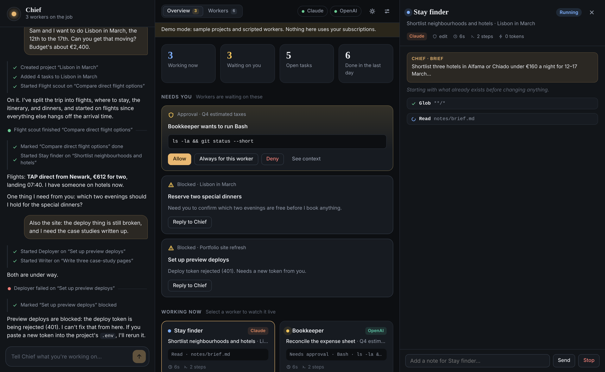

# QuietQuest

One conversation, every project.

QuietQuest is a personal agent harness built around a project manager. You talk to a single
agent. It turns what you tell it into projects and tasks, starts worker agents to do the work,
reviews what they hand back, and tells you only what needs you. A live dashboard shows every
project, task, and worker, so you can watch without managing threads.



It runs on the subscriptions you already pay for. The manager and the workers are sessions of
the official **Claude Code** and **OpenAI Codex** command-line tools, signed in with your Claude
and ChatGPT plans. QuietQuest never sees or stores your credentials.

## Quick start

Requires Node.js 20 or newer on macOS or Linux (Windows through WSL). There is nothing to
install: the project has no dependencies.

```bash
git clone https://github.com/aibusinessfrontier2025/quietquest.git
cd quietquest

npm run demo      # look around first: sample board, scripted workers, no subscription used
npm run doctor    # check that the CLIs are installed and signed in
npm start         # the real thing, at http://127.0.0.1:4747
```

Sign in once to whichever providers you want to use. One is enough.

| Provider | Install | Sign in |
| --- | --- | --- |
| Claude | `npm i -g @anthropic-ai/claude-code` | run `claude`, then `/login` with your Claude plan |
| OpenAI | `npm i -g @openai/codex` | run `codex login` with your ChatGPT plan |

Then tell the manager what you are working on:

> Plan five days in Lisbon in March for two, under €2,400. Start with flights and where to stay.

> In ~/code/my-app, find out why the test suite is flaky and fix the worst offender.

## What you see

- **Conversation** (left). The only thread you manage. The manager's actions appear inline as
  small check-marked lines; worker reports appear as one-line events you can open.
- **Needs you**. Approval requests from workers and tasks that are blocked on you, in one place.
- **Working now**. Every live worker with its current step, elapsed time, and which subscription
  it runs on.
- **Projects**. Each project with a progress bar and its tasks. Select a task to open the worker
  that handled it.
- **Worker detail** (right). The full transcript: the brief the manager wrote, every tool call
  with its input and output, and the final report. You can send the worker a follow-up or stop it.
- **Settings**. Which provider and model run the manager and the workers, how much workers may do
  without asking, concurrency limits, and the manager's memory about you.

## How it works

```
 you ──chat──▶ manager (one long-lived CLI session, read-only tools + the board tools)
                  │  create_project · create_tasks · spawn_worker · message_worker · update_task …
                  ▼
              QuietQuest daemon ──────────────▶ dashboard (HTTP + server-sent events)
                  │  queue, concurrency limit, approvals, transcripts, state on disk
                  ▼
              workers (one CLI session each, in the project's folder)
                  │  final report
                  └──────────▶ back to the manager as an event, which reviews and decides what is next
```

- **The manager delegates.** It runs with read-only tools plus a set of board tools that the daemon
  serves over MCP (`src/mcp-bridge.js`). It cannot edit files or run commands itself.
- **Workers start cold.** A worker sees the project's goal and notes, its task, and the brief the
  manager wrote. Each project has its own folder that its workers share; pass an existing
  path (for example a repository) when you describe the project and it is used instead.
- **Reports close the loop.** When a worker stops, its report is queued for the manager, which
  marks the task done, sends a follow-up, starts the next task, or flags it as blocked. Events that
  arrive while the manager is busy are batched into its next turn.
- **Sessions resume.** Both the manager and each worker keep their CLI session, so a follow-up
  continues with full context.
- **Every turn starts from the truth.** The manager's prompt opens with a snapshot of the board, so
  it stays accurate even after a restart or a compacted conversation.

### Autonomy and approvals

Each worker runs at one of three levels. The manager picks per task; the default is in Settings.

| Level | Claude worker | Codex worker |
| --- | --- | --- |
| `read` | may read and search the web; anything else is denied | `read-only` sandbox |
| `edit` (default) | file edits are accepted; anything else that needs permission becomes an approval card | `workspace-write` sandbox (no approval cards; blocked actions fail) |
| `full` | no permission checks | `danger-full-access` sandbox |

On an approval card you can allow once, allow that tool for the rest of the worker's run, or deny.
Workers use your normal CLI configuration, including any allow rules, MCP servers, and skills you
have set up for Claude Code or Codex.

### Using your subscriptions, not API credit

QuietQuest starts the CLIs as child processes and reads their JSON event streams. By default it
removes `ANTHROPIC_API_KEY` and `OPENAI_API_KEY` from the workers' environment so that usage is
billed to your plan login rather than to an API key. Set `providers.<name>.useApiKey` to `true` in
`config.json` if you want the opposite. The provider pills in the top bar show sign-in state, and
for Claude the share of your plan limit used, as reported by the CLI.

Two limits guard against a runaway loop: `workers.maxConcurrent` (default 4) and
`workers.maxSpawnsPerHour` (default 30).

## Where things live

Everything is plain files under `~/.quietquest` (override with `--home` or `QUIETQUEST_HOME`).

| Path | Contents |
| --- | --- |
| `config.json` | settings |
| `state.json` | projects, tasks, workers, approvals |
| `chat.jsonl` | the conversation |
| `memory.md` | what the manager remembers about you; edit it freely |
| `agents/<id>.jsonl` | each worker's transcript |
| `workspaces/<project>/` | project folders created for you |

Source layout:

| Path | Role |
| --- | --- |
| `bin/quietquest.js` | command-line entry point |
| `src/manager.js` | the conversation loop and turn queue |
| `src/workers.js` | worker lifecycle, scheduling, approvals |
| `src/tools.js` | the manager's tools |
| `src/providers/` | Claude and Codex adapters, plus the scripted mock used by the demo and tests |
| `src/mcp-bridge.js` | stdio MCP server the CLIs launch to reach the daemon |
| `src/server.js` | HTTP API, event stream, static files |
| `web/` | the dashboard (no build step) |

## Security

- The server binds to `127.0.0.1` only and refuses requests whose `Host` is not loopback.
- State-changing requests must be JSON and same-origin, so another website open in your browser
  cannot drive the manager.
- The tool bridge authenticates to the daemon with a random token generated at each start.
- Model output is rendered through an escaping markdown renderer; it never becomes markup.

Workers act on your machine with your account. `edit` is a sensible default; use `full` only for
projects where you would run the CLI that way yourself.

## Status

Verified end to end against the real Claude Code CLI: manager turns, the tool bridge, workers,
session resume, review turns, and approval cards. The Codex adapter is built against the Codex
CLI's flags and event format and is covered by parser and argument tests, and the tool-bridge
configuration was confirmed to load in Codex, but it has not yet been run with a signed-in ChatGPT
account.

```bash
npm test
```

## Also in this repository

`newsletter-signup.html` is a standalone newsletter signup page; its notes are in
[docs/newsletter-signup.md](docs/newsletter-signup.md).
